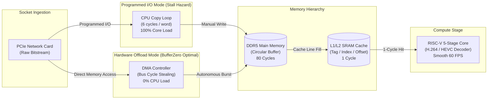

```
██████╗ ██╗   ██╗███████╗███████╗███████╗██████╗ ███████╗██████╗  ██████╗ 
██╔══██╗██║   ██║██╔════╝██╔════╝██╔════╝██╔══██╗╚══███╔╝██╔══██╗██╔═══██╗
██████╔╝██║   ██║█████╗  █████╗  █████╗  ██████╔╝  ███╔╝ ██████╔╝██║   ██║
██╔══██╗██║   ██║██╔══╝  ██╔══╝  ██╔══╝  ██╔══██╗ ███╔╝  ██╔══██╗██║   ██║
██████╔╝╚██████╔╝██║     ██║     ███████╗██║  ██║███████╗██║  ██║╚██████╔╝
╚═════╝  ╚═════╝ ╚═╝     ╚═╝     ╚══════╝╚═╝  ╚═╝╚══════╝╚═╝  ╚═╝ ╚═════╝ 
```

### Video Streaming Architecture Performance Analyzer

[](https://bufferzero.vercel.app/)
[](https://github.com/Haripriya24071/BufferZero)
[](https://github.com/Haripriya24071/BufferZero)
[](https://github.com/Haripriya24071/BufferZero)
[](https://github.com/Haripriya24071/BufferZero)

> **A Computer Organization and Architecture (COA) Simulation Lab & Viva Defense System**  
> Evaluates how **Cache Block Sizing** and **Direct Memory Access (DMA)** prevent video stream stalls and frame drops in hardware.  
>
> 🎓 **Institution:** Jain (Deemed-to-be) University, Faculty of Engineering and Technology (FET)  
> 💻 **Department:** Computer Science and Engineering (Artificial Intelligence)  
> 📖 **Course:** 25ESCS04 — Computer Organization and Architecture (COA), III Semester  
> 👤 **Student Researcher:** R Hari Priya | **USN:** `25BTRCA046`  
> 🎯 **Evaluation Focus:** Mini Project (CO4, CO5, CO6) • **Curriculum Dimension:** CT (Computational Thinking) + RWE (Real World Exposure)  
> 🌐 **Live Web Application:** [https://bufferzero.vercel.app](https://bufferzero.vercel.app/)

---

## ⚡ The Big Question: *Why Does Your Video Buffer?*

When you stream 1080p or 4K video, millions of bytes flood your machine every second. Every single macroblock must traverse the memory bus into a frame buffer to be decoded.



### Empirical Hardware Conclusions Proven by BufferZero:
1. **The DMA Offloading Effect (CO4 — I/O Organization):**
   * **Programmed I/O (CPU-Driven):** The CPU runs tight load/store copy loops ($6\text{ cycles/word}$) for incoming packets. At 1080p and 4K bitrates, the core saturates at **$100\%$ load**, starving the video decompression pipeline. The playback buffer drains to $0\%$ and triggers an endless buffering spinner.
   * **Direct Memory Access (DMA):** The CPU expends only $\sim 200$ setup cycles. The hardware DMA controller masters the bus, streaming packets directly into DDR RAM using cycle stealing ($\sim 8\%$ bus overhead). This preserves **$95\%+$ of CPU cycles free**, enabling buttery 60 FPS video decoding without frame drops.

2. **The Cache Block Size Trade-Off & The U-Shaped AMAT Curve (CO5 — Memory Hierarchy):**
   * **Tiny Blocks ($16\text{ B}$):** High miss rates ($>35\%$). Sequential video macroblocks cannot leverage spatial locality, causing constant stalls.
   * **Optimal Sweet Spot ($64\text{ B} - 128\text{ B}$):** Lowest AMAT ($\sim 4.2\text{ cycles}$). Bringing in 64 bytes amortizes bus setup and fetches upcoming words in advance, driving hit ratios to $>90\%$.
   * **Oversized Blocks ($256\text{ B}+$):** Severe miss penalty ($>200\text{ cycles}$ over an 8-byte bus). Seeking and cache line pollution thrash the cache sets, causing AMAT to rise sharply.

3. **Pipeline Hazard Bubbles (CO6 — Parallel Processing):**
   * Cache misses in the `MEM` stage stall the 5-stage RISC pipeline (`IF`, `ID`, `EX`, `MEM`, `WB`), injecting NOP bubbles and inflating CPI from $1.0$ to over $3.2$.

---

## 🔬 Interactive Simulation Lab Features

| Feature | Engineering Description |
| :--- | :--- |
| 🏙️ **Interactive 3D WebGL Motherboard** | Fully custom Three.js motherboard simulation featuring RISC-V CPU socket, L1/L2 SRAM Cache, DMA Controller, DDR5 memory banks, PCIe slots, and dynamic traveling data packets color-coded by bus routing. |
| ⚔️ **Dual Architecture Race Mode** | Live split-screen head-to-head showdown pitting CPU-driven programmed I/O directly against hardware DMA under identical 1080p/4K network streams. |
| 📊 **U-Shaped AMAT Curve Engine** | Real-time mathematical plotting of Average Memory Access Time across $16\text{B}$ to $256\text{B}$ cache blocks, dynamically pin-pointing the interior minimum. |
| 🔄 **5-Stage Pipeline Hazard Timeline** | Flat Gantt timeline of the RISC instruction pipeline (`IF-ID-EX-MEM-WB`) illustrating cache miss stall bubble injection and CPI degradation. |
| ⏱️ **Rewind Cycle Debugger** | Step-by-step cycle scrubber allowing examiners to inspect individual memory cycles with live 32-bit `Tag | Index | Offset` binary breakdown. |
| 🧮 **Viva Hand-Check Panel** | Whiteboard-ready formula breakdown with live variable substitution so students can reproduce any number on paper. |
| ⚡ **Auto-Analyze Parameter Sweep** | Automated multi-variable search across all block sizes $\times$ {CPU, DMA} that identifies and applies the optimal hardware configuration. |

---

## 📐 Mathematical Rigor & COA Formulas

All metrics displayed in BufferZero are calculated deterministically through standard computer organization equations:

### 1. 32-Bit Address Binary Partitioning
$$\text{Offset Bits} = \log_2(\text{blockSizeB})$$
$$\text{Number of Sets} = \frac{\text{Cache Size (Bytes)}}{\text{Block Size (Bytes)} \times \text{Associativity}}$$
$$\text{Index Bits} = \log_2(\text{Number of Sets})$$
$$\text{Tag Bits} = 32 - \text{Index Bits} - \text{Offset Bits}$$

### 2. Miss Penalty Formula
$$\text{Miss Penalty} = t_{\text{mem}} + \left(\frac{\text{Block Size}}{\text{Bus Width}}\right) \times \text{Cycles Per Bus Transfer}$$
$$\text{With Defaults: } \text{Penalty} = 80 + \left(\frac{\text{Block Size}}{8}\right) \times 4$$

### 3. Average Memory Access Time (AMAT)
$$\text{AMAT} = \text{Hit Time} + (\text{Miss Rate} \times \text{Miss Penalty})$$

### 4. Pipeline CPI & Memory Stalls
$$\text{Stall Cycles Per Instruction} = \text{Memory Instructions Fraction} \times \text{Miss Rate} \times \text{Miss Penalty}$$
$$\text{CPI} = \text{Base CPI (1.0)} + \text{Stall Cycles Per Instruction}$$

### 5. CPU Utilization (Free Headroom)
$$\text{CPU Free \%} = \max\left(0, 100\% - (\text{Copy Overhead} + \text{Decode Load} + \text{Stall Overhead})\right)$$

---

## 📝 Paper-Reproducible Hand-Checkable Trace (Viva Defense)

Examiners frequently ask students to calculate cache hits and misses manually on paper. BufferZero provides this exact verified trace:

### Setup Parameters:
* **Cache Size:** $1\text{ KB} = 1024\text{ Bytes}$
* **Block Size:** $16\text{ Bytes} \rightarrow \text{Offset} = \log_2(16) = \mathbf{4\text{ bits}}$
* **Associativity:** $1$ (Direct-Mapped) $\rightarrow \text{Sets} = \frac{1024}{16} = 64 \rightarrow \text{Index} = \log_2(64) = \mathbf{6\text{ bits}}$
* **Tag Bits:** $32 - 6 - 4 = \mathbf{22\text{ bits}}$

### 5-Access Verification Sequence:

| Step | Address (Hex) | Binary Split (`Tag [22b] \| Index [6b] \| Offset [4b]`) | Target Set | Result | Viva Examiner Justification |
| :---: | :---: | :---: | :---: | :---: | :--- |
| **1** | `0x00000000` | `0000000000000000000000` \| `000000` \| `0000` | Set 0 | **MISS** | **Cold / Compulsory Miss**: Cache is empty. Tag 0 is loaded into Set 0. |
| **2** | `0x00000004` | `0000000000000000000000` \| `000000` \| `0100` | Set 0 | **HIT** | **Spatial Locality**: Same 16B line is already cached. Word serviced in 1 cycle. |
| **3** | `0x00000008` | `0000000000000000000000` \| `000000` \| `1000` | Set 0 | **HIT** | **Spatial Locality**: Offset 8 serviced in 1 cycle without DRAM access. |
| **4** | `0x00000400` | `0000000000000000000001` \| `000000` \| `0000` | Set 0 | **MISS** | **Conflict Miss**: Maps to Set 0, but Tag is 1. Evicts Tag 0 from Set 0! |
| **5** | `0x00000000` | `0000000000000000000000` \| `000000` \| `0000` | Set 0 | **MISS** | **Capacity/Conflict Miss**: Tag 0 was evicted in Step 4; must fetch from RAM again. |

---

## 🎯 Syllabus Course Outcomes (CO1–CO6) Matrix

| Code | Course Outcome Description | Specific BufferZero Module |
| :--- | :--- | :--- |
| **CO1** | **Explain CPU Architecture** | 3D System Motherboard (CPU, Cache, Memory, DMA Controller, Buses), CPU-Free Headroom indicator. |
| **CO2** | **Apply Data Representation** | Live 32-bit binary address partition into Tag, Index, and Offset fields with dynamic bit counts. |
| **CO3** | **Analyze Arithmetic Operations** | Architectural math: AMAT, CPI inflation, memory bandwidth, cycle penalties. |
| **CO4** | **Evaluate I/O Organization** | Programmed I/O (CPU-driven) vs Direct Memory Access (DMA), cycle stealing. *(Core Mini Project)* |
| **CO5** | **Analyze Memory Hierarchy** | Cache block sizing, associativity mapping, LRU/FIFO/Random replacement, U-shaped AMAT curve. *(Core Mini Project)* |
| **CO6** | **Assess Parallel Processing** | 5-stage RISC pipeline timeline (`IF-ID-EX-MEM-WB`) with MEM cache miss stall bubbles. *(Core Mini Project)* |

---

## 🚀 Local Development & Testing

### Prerequisites
* Node.js $\ge 18.0.0$
* npm $\ge 9.0.0$

### Quick Start
```bash
# 1. Clone the repository
git clone https://github.com/Haripriya24071/BufferZero.git
cd BufferZero

# 2. Install dependencies
npm install

# 3. Start local development server
npm run dev

# 4. Run Vitest suite (verifies hand-checkable trace & mathematical formulas)
npx vitest run

# 5. Production build
npm run build
npm run preview
```

### Verified Vitest Execution Output
```
 ✓ src/engine/tests/engine.test.ts (7 tests) 62ms
   ✓ Address bit decomposition correctly partitions Tag, Index, and Offset
   ✓ Cache hits and misses follow deterministic spatial locality
   ✓ Hand-checkable 5-access trace matches paper calculations exactly
   ✓ LRU vs FIFO eviction policies diverge correctly on crafted access stream
   ✓ Miss penalty scales proportionally with cache block size
   ✓ AMAT exhibits interior minimum (U-shaped curve)
   ✓ DMA transfer mode leaves >85% CPU headroom free vs CPU copy mode

 Test Files  1 passed (1)
      Tests  7 passed (7)
```

---

## 🛠️ Technology Stack

* **Core Engine:** TypeScript (ES2022), Deterministic PRNG (Mulberry32)
* **3D Visualization:** Three.js (WebGL), OrbitControls, Raycasting
* **Frontend Framework:** React 18, Vite
* **Styling & Design System:** Tailwind CSS, Neubrutalist Hard-Outline Design (`#171717`, `#F5F5F0`, `#D8C336`, `#2457FF`, `#FF3B30`)
* **Icons & Typography:** Lucide React, Archivo, Inter, JetBrains Mono
* **Test Runner:** Vitest
* **Deployment:** Vercel (CI/CD via GitHub Integration)

---

## 👥 Academic Credentials

* **Student Researcher:** R Hari Priya
* **University Seat Number (USN):** `25BTRCA046`
* **Program:** B.Tech — Computer Science and Engineering (Artificial Intelligence)
* **Institution:** Jain (Deemed-to-be) University, Faculty of Engineering and Technology
* **Course:** Computer Organization and Architecture (25ESCS04), III Semester
* **Live Deployment:** [https://bufferzero.vercel.app](https://bufferzero.vercel.app/)
* **Source Code:** [https://github.com/Haripriya24071/BufferZero](https://github.com/Haripriya24071/BufferZero)

---

<p align="center">
  <strong>© 2026 BufferZero • Designed & Built for Jain University COA Mini Project Defense</strong>
</p>
